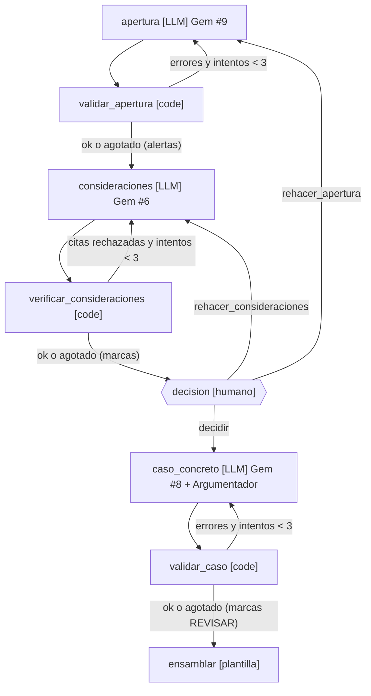

> Nota: el flujo vigente (primera instancia a segunda) está en `docs/superpowers/specs/2026-11-02-tutela2-primera-a-segunda-design.md`; este documento es el antecedente.

# Diseño preliminar v1: agente LangGraph para tutela de segunda instancia

Estado: borrador de diseño, sin implementación. Fecha: 2026-11-02.

**Fuentes del diseño:**
- Los Gems #9, #6 y #8, el Argumentador y el Depurador.
- La ficha verificada de la API de LangGraph 1.2.19.
- Tres diseños independientes (minimalista, por contratos, por experiencia del operador) y su revisión adversarial.
- El análisis de 3 casos reales del despacho (C1, C2, C3), del expediente de 1ª instancia al fallo de 2ª firmado.

---

## 0. Precondiciones (bloquean la construcción, no el diseño)

1. **Proveedor LLM de pago** con términos de no entrenamiento y no retención (Acuerdo PCSJA24-12243, arts. 8.1 y 8.6). Hay que definir también el equipo donde corre.
2. **Circulares** del Consejo Seccional de la Judicatura de Antioquia sobre herramientas de IA (en Risaralda solo se permite Copilot).
3. **Registro de la iniciativa** ante la UTDI (art. 14) y lugar donde va la divulgación del art. 10.
4. **Plantilla vigente** del despacho en .dotx/.docx (ver §6, generaciones A/B).
5. **Datos de prueba seudonimizados** antes de entrar a cualquier repositorio.

---

## 1. Principios

| # | Principio | Consecuencia |
|---|---|---|
| P1 | Un nodo LLM por cada prompt suyo, con una llamada por nodo | 3 nodos LLM: `apertura` (Gem #9), `consideraciones` (Gem #6), `caso_concreto` (Gem #8 + Argumentador) |
| P2 | El esquema da la forma; el código da las garantías | Salida estructurada (Pydantic, `method="json_schema"`, `include_raw=True`) seguida siempre de un validador de código. La temperatura no sirve: Gemini 3.6+ la ignora |
| P3 | La IA no valora ni decide; antes de la decisión solo hay texto descriptivo y dogmático | Pausa humana obligatoria antes del CASO CONCRETO. CONSIDERACIONES no aplica las normas al caso; se comprueba por código (§5). El RESUELVE sale de la decisión por plantilla (arts. 3.6, 8.3 y 8.4) |
| P4 | Lo fijo es plantilla; lo verificable lo verifica el código | Encabezado, fórmulas, competencia, procedibilidad base, transición, RESUELVE, M.P. y fechas los pone el código |
| P5 | Word es la interfaz y un expediente es un hilo | Un `SqliteSaver` por carpeta, `thread_id` = carpeta y un CLI de 3 órdenes. Sin servidor, Studio ni LangSmith |

---

## 2. Arquitectura

```
CLI `tutela2 nuevo <carpeta>`   (determinista, fuera del grafo)
  ingesta → completitud → metadatos → AutoAsume.docx + caso.json
                 │ falta pieza → correo de requerimiento (plantilla) y FIN
                 ▼
StateGraph (SqliteSaver, durability="sync")
  apertura[LLM] ⇄ validar_apertura[code]          (≤3 intentos)
        ▼
  consideraciones[LLM] ⇄ verificar_consideraciones[code]   (≤3; "Depurador determinista")
        ▼
  decision[HUMANO: interrupt(response_schema=Decision)]
        │ rehacer_apertura → apertura
        │ rehacer_consideraciones(instrucción) → consideraciones
        ▼ decidir
  caso_concreto[LLM] ⇄ validar_caso[code]          (≤3)
        ▼
  ensamblar[plantilla + code] → fallo.docx + informe_verificacion.docx + declaracion_ia.docx
        ▼
Revisión final en Word (fuera del grafo)
```



**Reglas de construcción:**
- `StateGraph` plano y síncrono: sin subgrafos, sin `Send`, sin `Command(goto)` y sin Functional API.
- Todo router lleva `-> Literal[...]` o `path_map`. Sin eso, `draw_mermaid()` dibuja aristas falsas; está verificado.
- Al agotarse los intentos no se aborta: se marca de forma visible y se sigue.

---

## 3. Preprocesamiento determinista (CLI, antes del grafo)

| Paso | Qué hace | Defecto o necesidad real que lo justifica |
|---|---|---|
| Extracción por página | `pdftotext`; si la página no tiene texto, OCR en español (tesseract `spa`) y marca `ocr=True` por página | Hay páginas imagen dentro de PDF con texto en los 3 casos; en C1 una contestación completa está escaneada. La detección por archivo no basta |
| Rol del documento | Por nombre de archivo (`NNNEscritoTutela`, `FalloTutela`, `Impugnacion`, `Respuesta*`, `ActaReparto*`, `Auto*`, `Notifica*`) y palabras clave | La nomenclatura del expediente electrónico es estable en los 3 casos |
| Filtro de ruido | Descarta certificados de existencia, avisos de correo, duplicados por hash y copias del fallo dentro de la impugnación | En C3 el 97 % de un anexo de 69 páginas eran certificados |
| Guardia de radicado | CUI de 23 dígitos; los 21 primeros deben coincidir; sufijo 00 en 1ª y 01 en 2ª. Lo que no corresponde va a `docs_ajenos`, salvo que su texto nombre a las partes o al juzgado a quo (`docs_revisar`) | C3 traía un documento de otro caso y se notificó a direcciones ajenas |
| Completitud | Exige acta de 2ª, escrito, auto admisorio, fallo a quo, impugnación y auto que concede. Si falta algo, genera el correo de requerimiento y no crea el hilo | En C3 faltaba la impugnación y hubo que pedirla |
| Metadatos | CUI, fechas de admisión, fallo, notificación, impugnación, concesión y reparto, juzgado a quo y partes del acta de 2ª, con regex anclada; lo dudoso lo resuelve `apertura` | Encabezado, I. ASUNTO y AutoAsume |
| AutoAsume.docx | Plantilla pura (2 variantes de cierre y de "recibidas el día de ayer") | 3/3 casos; es lo primero que produce el despacho |

Tamaño: el núcleo limpio de 1ª instancia está entre 120 mil y 200 mil caracteres. Se envía completo y **sin RAG**. Si un caso supera el tope configurable, se procesa por documento.

---

## 4. Estado (boceto)

```python
class Decision(BaseModel):
    accion: Literal["decidir", "rehacer_apertura", "rehacer_consideraciones"]
    instruccion: str = ""
    resultado: Literal["CONFIRMAR", "REVOCAR", "MODIFICAR"] | None = None
    sustitutiva: Literal["AMPARAR", "NEGAR", "IMPROCEDENTE", "CARENCIA_HECHO_SUPERADO",
                         "CARENCIA_DANO_CONSUMADO", "CARENCIA_SOBREVINIENTE"] | None = None
    eje: str = ""
    por_reparo: list[DisposicionReparo] = []
    derechos: list[DisposicionDerecho] = []
    ordenes: list[Orden] = []
    desvincular: list[str] = []
    prevenir: list[str] = []
    compulsa: Compulsa | None = None
    numerales: NumeralesEstandar = NumeralesEstandar()
    decidido_por: str = ""
    previo_sha256: str = ""
```

**`Decision`** es el `response_schema` de la pausa.
- Si la respuesta es inválida: `ValidationError`, no se guarda nada y la pausa sigue pendiente (verificado).
- Validadores del modelo:
  - con `decidir`: `resultado`, `sustitutiva` y `eje` son obligatorios;
  - con `AMPARAR`: exige al menos una `Orden`;
  - con `rehacer_*`: exige `instruccion`.
- Tipos auxiliares:
  - `DisposicionReparo = {reparo_id, disposicion: ACOGE|DESESTIMA|ACOGE_PARCIAL|REFORMULA|ABSORBIDO, nota}`
  - `DisposicionDerecho = {derecho, disposicion: AMPARA|NIEGA|SIN_PRONUNCIAMIENTO}`
  - `Orden = {verbo: ORDENAR|PREVENIR|ADVERTIR, destinatario, via_representante, conducta, plazo{n, unidad}, condicion?, literales[]}`

**Campos del `Estado`** (TypedDict con tipos Pydantic declarados y `LANGGRAPH_STRICT_MSGPACK=true`):

| Campo | Contenido |
|---|---|
| `caso_id`, `plantilla_gen` | `plantilla_gen` es `"A"` o `"B"` |
| `documentos[]` | `{doc_id, rol, sha256, paginas[{n, texto, ocr}]}` |
| `docs_ajenos[]` | |
| `docs_revisar[]` | Documentos con CUI de otro radicado cuyo texto nombra al accionante, a la accionada o al juzgado a quo: no son ajenos; van al modelo con una marca de advertencia hasta que el usuario los confirma |
| `metadatos` | `{cui_1a, cui_2a, fechas{...}, a_quo, accionante, accionadas[], vinculadas[], impugnante{tipo, rol, apoderado}}` |
| `modelo`, `prompts{nodo: texto}`, `prompts_sha256{}`, `corte_indice` | Se fijan al crear el hilo |
| `apertura` | `{cronologia[Evento], antecedentes, contestaciones[{entidad, texto, silencio}], sentencia_impugnada, impugnacion, reparos[Reparo], pruebas_nuevas_2a[]}` |
| `consideraciones` | `{procedibilidad_aplicada, bloques[{tema, reparo_ids, texto, banco_id?}], citas[Cita]}` |
| `citas_verificadas[]` | `{id, sentencia, estado: ok|alerta|rechazada, mp_dataset, fecha_dataset, url, cobertura, motivo}` |
| `decisiones` | `Annotated[list[Decision], operator.add]`; manda la última |
| `caso` | `{problema_juridico, parrafos[{reparo_ids, texto}], conclusion}` |
| `errores` | Del último validador; se sobrescribe |
| `alertas` | `dict[nodo, list[str]]`, sobrescrito por nodo, para que solo se vean las vigentes |
| `intentos{nodo: int}` | |
| `bitacora` | `Annotated[list[LlamadaIA], operator.add]` |
| `salidas{ruta: sha256}` | |

**El formulario de decisión va por niveles**, para que en el caso típico sea corto:

| Nivel | Campos | Comportamiento |
|---|---|---|
| 1 | `resultado`, `sustitutiva`, `eje` | Siempre obligatorios |
| 2 | `por_reparo`, `derechos` | Vienen precargados desde la extracción; se aceptan por defecto |
| 3 | `ordenes` | Solo aparece si `sustitutiva = AMPARAR` |
| 4 | `desvincular`, `prevenir`, `compulsa`, `numerales` | Ocultos tras "otros numerales"; los estándar vienen activados |

`LlamadaIA = {nodo, intento, modelo_pedido, modelo_efectivo, prompt_id@version, sha256(instrucciones, entrada, salida), fecha, error_parseo}`.

El `Ctx` no se persiste. Lleva solo la fábrica de LLM y el cliente HTTP, y se reenvía en cada `invoke`; está verificado que el contexto no viaja en el checkpoint.

---

## 5. Nodos del grafo

| Nodo | Tipo | Responsabilidad | Reglas que debe cumplir (con origen) |
|---|---|---|---|
| `apertura` | LLM | Gem #9 sin encabezado ni fórmula de ASUNTO. Produce cronología anclada, II. ANTECEDENTES (hechos, pretensiones y un párrafo por entidad, que cierra con su pretensión defensiva o con "guardó absoluto silencio"), III. SENTENCIA IMPUGNADA (ratio requisito por requisito), IV. IMPUGNACIÓN (un párrafo por reparo y la petición concreta), `reparos[]` con su ancla y `pruebas_nuevas_2a` | IV debe cubrir **todos** los reparos o llevar la marca "no incluir" del humano. Según el análisis, C1 recogió 3 de unos 6 [análisis] |
| `validar_apertura` | code | Anclas literales; toda fecha, número, radicado o C.C. de la prosa debe existir en las fuentes (0 ajenos); fechas válidas y coherentes entre secciones; prosa sin viñetas; ids de reparo únicos; contestaciones iguales a las entidades notificadas o con el silencio declarado; hechos que solo vienen de OCR van a alerta | Defectos reportados por el análisis: documento y datos de un tercero (C3), fecha "31 09 2026" en el Formato (C2), atribuciones a partes que no están en su escrito (C1) [análisis] |
| `consideraciones` | LLM | Gem #6, pero **solo lo variable y solo en el plano dogmático**: marco de procedibilidad (inmediatez, subsidiariedad, perjuicio irremediable) **elegido según los reparos**, por ejemplo la doctrina del tracto sucesivo si el reparo es de inmediatez, **sin subsunción**. Además, **hasta 3 bloques temáticos** ligados a reparos y derechos (3/3 casos tienen exactamente 3). Prefiere bloques del banco por id. Citas con `[[CITA:id]]` y `texto_citado`. La aplicación al caso va en `caso_concreto` (Gem #8, ítem 2), después de la decisión | Competencia, procedibilidad base y transición **no se generan**: son plantilla (C2 y C3 comparten unas 375 palabras literales). Gem #6: "No resolver el caso concreto ni valorar las pruebas particulares… mantener el desarrollo en el plano dogmático" |
| `verificar_consideraciones` | code + HTTP | Es el **Depurador determinista**. (a) Existencia en el dataset `v2k4-2t8s`; el M.P. y la fecha los escribe el código. (b) La página de relatoría se valida por contenido, para descartar el soft-404 de 8.607 bytes. Patrones verificados: `T-NNN-AA.htm`, `C-NNN-AA.htm`, `SUNNN-AA.htm`. (c) Cobertura literal de la cita por 6-gramas: ≥0,8 pasa, 0,5–0,8 alerta, <0,5 rechaza (umbral inicial, calibrable). (d) Toda sentencia lleva M.P. (e) "La Corte ha sostenido…" sin sentencia identificada es alerta. (f) Cada reparo tiene al menos un bloque. (g) **Guardia de P3**: V no puede contener nombres de las partes, fechas del caso ni datos de los documentos tomados de `metadatos` o `documentos`. Una cita rechazada vuelve a `consideraciones` con el motivo y la Regla de oro del Depurador: cambiar la cita, nunca la tesis | Ver §8: habría marcado las 6 citas con problemas de C1 y C2, incluido el M.P. errado de T-892/11 |
| `decision` | humano | Un único `interrupt(payload, response_schema=Decision)`, sin nada antes, porque el nodo se re-ejecuta al reanudar. El payload trae los reparos, la decisión del a quo, el informe de citas, las alertas y las pruebas nuevas de 2ª | Arts. 3.6, 8.3 y 8.4: el humano decide y da el `eje` |
| `caso_concreto` | LLM | Gem #8 (ítems 1–5) + Argumentador: problema jurídico ("Corresponde al Despacho determinar si…"), párrafos etiquetados por reparo y conclusión que anticipa el RESUELVE. Desarrolla el `eje` y las disposiciones humanas. Puede insertar marcadores `[[IMAGEN doc pág pie]]` | No recibe los documentos crudos. Solo puede citar sentencias ya verificadas |
| `validar_caso` | code | Jurisprudencia de VI ⊆ jurisprudencia de V, por identificador normalizado; las normas quedan en lista blanca porque en C1 y C3 aparecen normas en VI que no estaban en V. Sin títulos ni viñetas (parámetro `permitir_listas`, ver pregunta 4). Todo reparo no ABSORBIDO tratado. Conclusión coherente con `resultado` y `sustitutiva` (lemas). Extensión en el rango del parámetro. Residuos de borrador ("Nota:", "TODO", "[", párrafos cortos que empiezan en infinitivo). Párrafos casi duplicados (Jaccard ≥0,5). Datos de menores, correos y direcciones como alerta | Defectos reportados por el análisis: "improcedente" en V frente a NEGAR en el RESUELVE (C3), residuos de borrador (C1), párrafos duplicados (C2), un reparo sin resolver en sus propios términos (C3) [análisis] |
| `ensamblar` | plantilla + code | docxtpl con la plantilla de `plantilla_gen`. Fecha en letras y cifras por código. "Decisión" del encabezado derivada de `Decision`. Citas renderizadas como "Sentencia T-NNN de AAAA, con ponencia del Magistrado X", con M.P. del dataset. RESUELVE desde la biblioteca de numerales, con ordinales consecutivos y numeración romana automática. Por defecto NOTIFICAR (art. 30 D. 2591) y REMITIR a la Corte (el numeral no cita artículo; ver la nota de la pregunta 7). Las citas rechazadas salen como `⟦CITA NO VERIFICADA⟧`. Además genera `informe_verificacion.docx` y `declaracion_ia.docx` (mapa sección → plantilla/IA/humano, bitácora y decisión con autor y fecha) | **Verificado:** C3 remite a la Corte "de conformidad con el artículo 31", pero la remisión tras el fallo de 2ª la regula el art. 32 ("dentro de los diez días siguientes a la ejecutoria del fallo de segunda instancia, el juez remitirá el expediente a la Corte Constitucional"). C3 no trae numeral NOTIFICAR, aunque cierra con "NOTIFÍQUESE Y CÚMPLASE" (ver pregunta 7). Ninguno de los 3 fallos divulga el uso de IA (art. 10) [análisis] |

**Validadores: bloqueantes frente a alertas (v1).**
- **Bloquean**, es decir, provocan un reintento y, si se agota, una marca visible en el documento:
  - cita no localizada o M.P. que no coincide con el dataset;
  - una sentencia de VI que no está en V;
  - CUI incoherente o datos ajenos al caso;
  - V con hechos del caso (guardia de P3);
  - incoherencia entre la conclusión de VI, el encabezado y el RESUELVE frente a `Decision`.
- **Solo alertan** (aparecen en el informe):
  - extensión;
  - duplicados;
  - residuos de borrador;
  - listas en VI;
  - "la Corte ha sostenido" sin sentencia;
  - datos personales;
  - hechos que solo vienen de OCR;
  - antigüedad de las sentencias.

---

## 6. Plantillas y banco

**Dos generaciones de plantilla** en una muestra de 3 casos (pregunta 1):

| Rasgo | Gen A (C1) | Gen B (C2, C3) |
|---|---|---|
| Títulos III–V | FALLO RECURRIDO / IMPUGNACIÓN / CONSIDERACIONES DEL JUZGADO | LA SENTENCIA IMPUGNADA / LA IMPUGNACIÓN / CONSIDERACIONES |
| Competencia | En VI | En V |
| Fórmula de mérito | "…en nombre del Pueblo y por mandato Constitucional," | "…en nombre de la República y por autoridad de la Ley," |
| Tabla del encabezado | 6 filas, etiquetas en mayúsculas | 7 filas (Vinculada/os, Derechos) |

**Biblioteca de numerales del RESUELVE:**
- Validados con fallos reales: REVOCAR, AMPARAR, NEGAR, ORDENAR (núcleo fijo "a través de su representante legal y/o quien haga sus veces, que, dentro de las cuarenta y ocho (48) horas hábiles…"), PREVENIR, DESVINCULAR, COMPULSAR, NOTIFICAR, REMITIR.
- CONFIRMAR, MODIFICAR y CARENCIA salen solo de los Gems y **no tienen fallo real que los valide**.

**Banco de bloques verificados.** Es un archivo de datos, no código:
- Estructura: `{id, tema, gen, texto, citas[{sentencia, mp_dataset, fragmento, url, cobertura}]}`.
- Se siembra solo con citas que pasaron la verificación (≥0,8): T-200/22 (hecho superado), SU-082/95 (hábeas data), C-321/22 (debido proceso sancionatorio), SU-712/13 (subsidiariedad) y T-554/19 (perjuicio irremediable, en lugar de T-048/10).
- Crece cuando él aprueba un bloque nuevo.

---

## 7. Intervención humana y reanudación

| Orden del CLI | Qué pasa |
|---|---|
| `tutela2 nuevo <carpeta>` | Preprocesa, emite AutoAsume.docx, crea el hilo y corre hasta `decision`. Genera `previo.docx` (I–V + informe de citas) desde `get_state` y termina. No queda nada corriendo |
| `tutela2 decidir <carpeta>` | Comprueba `next == ("decision",)`, pide la `Decision` (formulario corto; variante: leerla de una tabla en `DECISION.docx`) y reanuda con `Command(resume=decision.model_dump(mode="json"))` |
| `tutela2 continuar <carpeta>` | Tras una caída a mitad de un nodo, ejecuta `invoke(None, cfg)`, que re-ejecuta solo el nodo fallido (verificado) |

- Rehacer va solo por aristas normales. Él no usa `update_state` ni forks.
- Si hace falta volver a decidir, se bifurca desde el checkpoint de compuerta **más reciente**, elegido por `metadata.step`, porque los bucles crean varios (verificado).

---

## 8. Validación contra los 3 casos reales

**Procedencia de los datos de este documento:**
- Sin marca: verificado en esta sesión con scripts deterministas contra el dataset `v2k4-2t8s`, la relatoría oficial o Función Pública.
- **[análisis]**: lo reportaron los agentes que analizaron cada caso y falta confirmarlo.

**Verificación de citas.** Se revisaron **13 citas literales** (pasajes entre comillas que siguen a una sentencia). La medida es la cobertura de 6-gramas sobre el texto oficial normalizado.

| Caso | Cita en el fallo firmado | Resultado |
|---|---|---|
| C1 | T-048/10 (perjuicio irremediable) | No localizada en T-048/10 (0 %); coincide parcialmente (39 %) con T-225/93 |
| C1 | T-210/14 (procedibilidad) | No localizada (7 %) |
| C2 | SU-391/16 (inmediatez) | No localizada (0 %) |
| C2 | T-892/11 (subsidiariedad) | No localizada (3 %), y **M.P. distinto**: el fallo dice Luis Ernesto Vargas Silva; la relatoría dice "Magistrado ponente: NILSON PINILLA PINILLA" |
| C2 | T-468/03 (actividad financiera) | No localizada (3 %) |
| C2 | T-048/10 | Localizada al 100 % en **otra sentencia**, T-554/19 |
| C1 | T-200/22 (×2), C-321/22, SU-082/95 | 100 % |
| C2 | T-157/14 | 100 % |
| C3 | SU-712/13 (el mismo bloque, ×2) | 100 % |

**Resumen:**
- 7 de 13 apariciones coinciden; son 5 pasajes distintos.
- 6 citas tienen problemas: 5 no localizadas y 1 atribuida a otra sentencia. A eso se suma 1 M.P. distinto del oficial.
- **Límites:** solo se revisaron las citas seguidas de comillas dentro de una ventana de 400 a 900 caracteres. La comparación del M.P. solo se hizo donde el fallo lo menciona.

**Conclusión:** los fallos firmados sirven como **referencia de estructura y cobertura, no como texto de oro**.

**Pruebas de regresión:**
- **Deterministas, deben pasar al 100 %:** orden de secciones, bloques fijos idénticos a la plantilla, RESUELVE esperado dada la decisión real reproducida, encabezado y fechas.
- **Extracción:** recall de reparos (C1 ≈6, C2 3, C3 4) y de contestaciones (C1 4, C2 0, C3 1 más el informe).
- **Mutación:** se inyectan en un borrador correcto los defectos reales encontrados y los validadores deben marcarlos todos:
  - M.P. de T-892/11;
  - citas no localizadas o atribuidas a otra sentencia;
  - art. 31 en lugar del 32 al REMITIR (hoy el numeral REMITIR no cita artículo y no hay validador de este defecto; ver la nota de la pregunta 7);
  - competencia duplicada [análisis] (la competencia sale de plantilla, `COMPETENCIA_1`, en un solo párrafo; no hay un validador específico);
  - fecha 31/09 [análisis];
  - radicado ajeno [análisis];
  - "improcedente" frente a NEGAR [análisis];
  - residuos de borrador [análisis].
- **V y VI no se califican por similitud** con el fallo real. Se califican con una rúbrica suya sobre salidas ciegas.
- **Umbrales:** se calibran dejando un caso fuera (ajustar con 2, probar con 1) y se congelan.
- **Estabilidad:** cada caso se corre 3 veces y se reporta la varianza.

---

## 9. Fuera de v1 y qué lo activaría

| Diferido | Activador |
|---|---|
| Depurador LLM con búsqueda (sustituir por sentencias hito) | Tasa alta de citas rechazadas que el banco no cubre |
| Citas de la Corte Suprema y del Consejo de Estado | No tienen API; hoy los 3 casos citan solo a la Corte Constitucional |
| Formato Factor Calidad | v1.1: secciones 1–2 deterministas con validación de sumas (en C1 un subtotal no cuadraba [análisis]); puntajes humanos |
| VII. OTRAS DETERMINACIONES redactada por IA | v1: la `Compulsa` en la decisión genera el numeral; él escribe la narración |
| Inserción automática de imágenes | v1 deja marcadores; él pega la captura en Word |
| Correos de notificación y envío | v1.1, con plantilla y lista blanca de destinatarios |
| Control de cambios (docx-redline), servidor, Studio, Postgres, cifrado | Según el equipo y el uso real |

---

## 10. Preguntas abiertas (por impacto)

1. **Plantilla vigente: ¿Gen A o Gen B?** Necesitamos el .dotx.
2. **Proveedor, equipo y cumplimiento:** circulares de Antioquia, registro del art. 14 y lugar de la divulgación del art. 10.
3. **Decisión:** ¿global o reparo por reparo? ¿Escribirá el `eje` (2–5 líneas), que este diseño vuelve obligatorio?
4. **Extensión del CASO CONCRETO.** El Argumentador pide "una hoja" (≈330 palabras). Los casos reales tienen entre 1.160 y 2.730 palabras (3,5–8 hojas). ¿Se permiten listas, como en C2? ¿Es obligatorio citar en VI? C2 no cita ninguna sentencia.
5. **¿Consideraciones antes o después de decidir?** Su flujo dice antes. En los 3 casos V está alineado con el eje de la decisión, lo que sugiere que se escribió conociéndola. Este diseño mantiene su orden y usa "rehacer consideraciones con instrucción" para alinear.
6. **Banco de párrafos.** ¿Tiene uno? ¿Acepta congelar los bloques verificados?
7. **RESUELVE estándar.** ¿NOTIFICAR va siempre como numeral? C1 y C2 lo traen; C3 solo cierra con "NOTIFÍQUESE Y CÚMPLASE". ¿REMITIR con el art. 32? ¿"Horas hábiles"? ¿El amparo en un SEGUNDO aparte?

    Estado actual del artículo: el numeral REMITIR no cita artículo y el oficio a la Corte cita el 31. Los 9 fallos reales citan, al remitir, el 31 solo (12001, 40601), el 32 solo (37401, 45601, 49501), ambos (45301, 45901) o ninguno (53001, 34601); los 3 oficios reales citan el 31. Falta que el despacho confirme el 31 o el 32 (ver `README.md`, Limitaciones conocidas).
8. **Más ejemplos.** Para 3–5 casos nuevos, ¿puede guardar las salidas intermedias de cada Gem? Faltan también CONFIRMA, MODIFICA, carencia actual de objeto, una impugnación de la accionada y un caso de salud.
